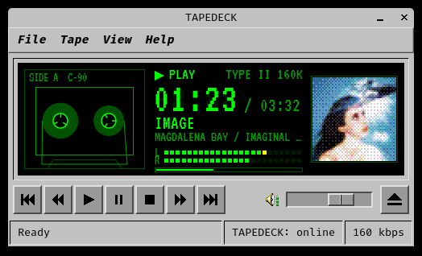
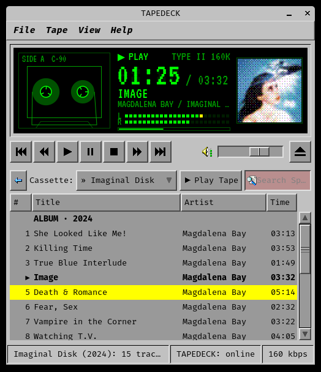
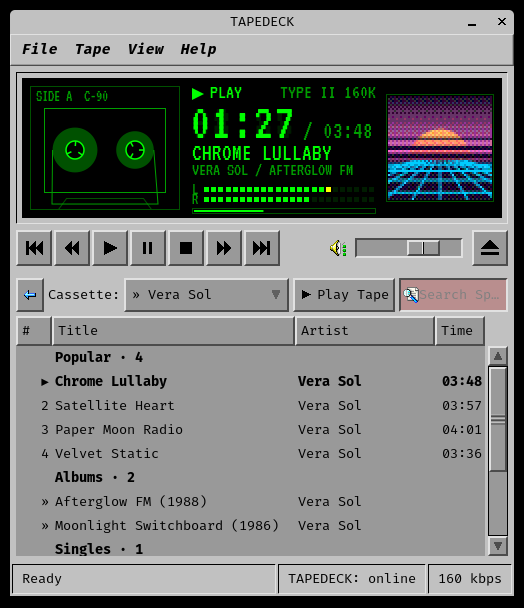

# TAPEDECK

A lightweight Spotify player for Linux that looks like a 1990s desktop utility: a cassette deck with spinning reels, a green LCD readout and VU meters, in a window styled like an old SGI or Windows 98 program.

It plays your playlists, Liked Songs, albums and artists; it has search, a play queue and artist radio. It was written to run comfortably on old hardware: with the window hidden or the music paused it uses next to no CPU.



| An album open in the drawer | An artist page |
|---|---|
|  |  |

<sub>Shown: Magdalena Bay, *Imaginal Disk* (2024).</sub>

## How it works
TAPEDECK has two parts:
- **The deck** (this app) is the window you see. It browses your library and sends play, pause, skip and so on to Spotify.
- **The engine** is [librespot](https://github.com/librespot-org/librespot), an open-source Spotify player that does the actual streaming. To Spotify it looks like a speaker called **TAPEDECK**, the same kind of device as a smart speaker. The deck starts it when you open the window and stops it when you quit.

Because the engine is an ordinary Spotify speaker, you can also pick TAPEDECK from the Spotify app on your phone and play to it.

## What you need
- Linux with an X11 or Wayland desktop
- PulseAudio or PipeWire (with the `pacat`, `parec` and `pactl` tools)
- Python 3 with GTK 3 bindings. On Debian or Ubuntu: `sudo apt install python3-gi gir1.2-gtk-3.0 pulseaudio-utils`
- Rust's `cargo`, to build librespot (from [rustup.rs](https://rustup.rs) or your package manager)
- **Spotify Premium.** Spotify only lets Premium accounts stream to third-party players.

## Install
**1. Get TAPEDECK.** Put the folder wherever you like and run the rest of the commands from inside it.
```
git clone https://github.com/demrich/tapedeck.git
cd tapedeck
```

**2. Install librespot** (the engine). This builds it from source and takes a few minutes:
```
cargo install librespot --version 0.8.0 --locked --no-default-features --features rustls-tls-native-roots
```
TAPEDECK looks for `librespot` on your `PATH`, then in `~/.cargo/bin`. To use a copy somewhere else, set `LIBRESPOT=/path/to/librespot`.

**3. Create your own Spotify app.** To read your playlists and control playback, TAPEDECK uses Spotify's Web API, and Spotify requires every user of the API to register an app. It's free and takes a minute:
1. Go to the [Spotify Developer Dashboard](https://developer.spotify.com/dashboard) and log in.
2. Click **Create app**. Name and description can be anything.
3. Set the **Redirect URI** to exactly `http://127.0.0.1:8898/callback`.
4. Under the APIs used, tick **Web API**, then save.
5. Copy the app's **Client ID**.

Then give TAPEDECK the Client ID and log in. A browser window opens for you to approve access:
```
python3 -m tapedeck.cli setup YOUR_CLIENT_ID
python3 -m tapedeck.cli login
```

**4. Log the engine in to Spotify.** Run it once by hand. It opens your browser to log in, then remembers you:
```
bin/tapedeck-engine
```
Once you've approved it in the browser, press `Ctrl+C`. From then on TAPEDECK starts the engine for you.

**5. Add TAPEDECK to your applications menu:**
```
bin/tapedeck-install
```
This adds a menu entry with an icon and registers the engine as a background service for your user (systemd). It only writes inside your home folder. If you move the TAPEDECK folder later, run it again.

To remove all of it: `bin/tapedeck-install --uninstall`

## Using it
Open **TAPEDECK** from your applications menu (under Multimedia), or run `bin/tapedeck`. The status bar says `TAPEDECK: online` a few seconds after launch, once the engine is connected.

- **The drawer** is the panel under the deck. Open and close it with the eject button or `E`. Its **Cassette** menu switches between Liked Songs, your playlists, search results, the play queue and any artist or album pages you've opened.
- **Playlists you follow** but didn't create are marked `[sealed]`. Spotify doesn't let personal apps read other people's playlists, so TAPEDECK can play them but can't list their tracks. Instead, it writes down each song as you hear it, and the list fills in over time.
- **Closing the window** hides TAPEDECK in your panel's system tray and the music keeps playing. Click the tray icon to bring it back; right-click it for playback controls and Exit. To quit, use **File → Exit** or `Ctrl+Q`. On desktops without a system tray (most Wayland desktops), closing the window quits.

### Keyboard
| Key | Action |
|---|---|
| `Space` | Play / pause |
| `S` | Stop |
| `H` / `L` | Previous / next track |
| `Shift+H` / `Shift+L` | Back / forward 10 seconds |
| `+` / `-` | Volume up / down |
| `E` | Open / close the drawer |
| `/` | Search |
| `Enter` | Play the selected track, or open the selected album or artist |
| `Q` | Add the selected track to the queue |
| `A` / `B` | Open the artist / album of the selected track (or of the one playing) |
| `R` | Start radio from the selected track or artist |
| `Backspace` or `Alt+Left` | Back to the previous page |
| `Esc` | Leave the search box |
| `?` | Show this list in the app |
| `Ctrl+Q` | Quit |

## Artist pages and radio
Press `A` or `B` on a track to open its artist or album. You can also click the artist name or the album cover on the display. An artist page lists their popular tracks, albums, EPs and singles, and similar artists. Every page you open is added to the Cassette menu, and `Backspace` goes back.

Spotify doesn't give personal apps its popular tracks, similar artists or radio. TAPEDECK gets those from [Deezer](https://www.deezer.com)'s public catalogue, which needs no account, and then finds each song on Spotify. A song is only used if the artist and title both match, so radio never plays a wrong song. When a song can't be found, it's left out. Starting radio takes a few seconds.

When a playlist or album ends, Spotify's autoplay keeps similar music going.

## Use it as a Spotify speaker
To keep TAPEDECK available as a speaker even with the window closed, so you can play to it from your phone anytime, start the engine with your login:
```
systemctl --user enable --now tapedeck-engine
```
Idle, it uses about 24 MB of memory and no CPU. To turn it off: `systemctl --user disable --now tapedeck-engine`

## Media keys and scripting
TAPEDECK works with your keyboard's media keys, Bluetooth headphone buttons and desktop media widgets, which show the current track and cover. It does this through MPRIS, the standard Linux interface for media players.

If your media keys don't reach it, bind them in your desktop's keyboard settings to `bin/tapedeck-key PlayPause`, `Next`, `Previous` and `Stop`.

Scripts and custom hotkeys can trigger these actions: `play-pause`, `next`, `previous`, `stop`, `eject`, `artist`, `album` and `radio`. For example:
```
gdbus call --session --dest cc.haunts.haven.tapedeck --object-path /cc/haunts/haven/tapedeck \
  --method org.gtk.Actions.Activate next [] {}
```

## Appearance
TAPEDECK always looks like the screenshots, whatever theme your desktop uses. Its retro look comes with the app, and none of it is installed on your system:
- the **IndigoMagic** widget theme, modelled on SGI's IRIX workstations
- the **SE98** icons, modelled on Windows 98
- the **Fira Code** and **VT323** fonts

Only the title bar and window border come from your desktop. To use your desktop's own theme and icons instead, start it with `TAPEDECK_SYSTEM_THEME=1 bin/tapedeck`.

## Settings
These are set as environment variables, for example `TAPEDECK_FPS=15 bin/tapedeck`:
- `TAPEDECK_FPS`: reel and meter animation frame rate (default `10`). Higher is smoother but uses more CPU.
- `TAPEDECK_BITRATE`: stream quality in kbps: `96`, `160` (default) or `320`. Applies when TAPEDECK starts the engine without the service; for the service, edit `~/.config/systemd/user/tapedeck-engine.service`.
- `TAPEDECK_SYSTEM_THEME=1`: use your desktop theme (see Appearance).

## Files
- `~/.config/haven/tapedeck/`: your Client ID and Spotify login. Delete it to log out.
- `~/.cache/haven/tapedeck/`: saved playlists and album covers, which TAPEDECK downloads again if you delete them. Its `librespot` folder holds the engine's login; deleting it means repeating install step 4.

## Performance
TAPEDECK was built and measured on a 2013 MacBook Pro (dual-core i5, 8 GB):

| | CPU | Memory |
|---|---|---|
| Playing, window visible | about 10 % of one core, including the desktop's share for redrawing it | deck 78 MB, engine 24 MB |
| Playing, minimized or in the tray | about 1 % | same |
| Paused | about 0 % | same |

The animation costs the most. The reels and VU meters only move while music plays in a visible window, and they stop when it's paused, minimized or on another workspace.

## Troubleshooting
- **`TAPEDECK: offline`** means the engine isn't connected. Check its log: `journalctl --user -u tapedeck-engine`. If the service isn't installed, the log is in `$XDG_RUNTIME_DIR/tapedeck/engine.log`.
- **"INSERT CASSETTE: File > Sign In to Spotify"** means TAPEDECK has no Spotify login yet (logins renew on their own after that). Use File → Sign In, or run `python3 -m tapedeck.cli login`.
- **Testing from a terminal:** `python3 -m tapedeck.cli devices`, `now`, `search <words>`, `playlists`, `play [uri]`, `pause`, `next` and `previous` talk to Spotify directly.

## License
TAPEDECK is free software under the GNU General Public License, version 3 or later ([LICENSE](LICENSE)). Fork it, change it, share it.

## Credits
- IndigoMagic GTK theme, based on OneStepBack by Dave Maldonado: GPL-3.0 (`share/themes/TAPEDECK-IndigoMagic/COPYING`)
- SE98 icons by nestoris ([github.com/nestoris/Win98SE](https://github.com/nestoris/Win98SE)): GPL-2.0 (`share/icons/TAPEDECK-SE98/COPYING`)
- Fira Code ([github.com/tonsky/FiraCode](https://github.com/tonsky/FiraCode)) and VT323 by Peter Hull: SIL Open Font License 1.1 (`share/fonts/`)
- librespot (installed separately): MIT
- Popular tracks, similar artists and radio from Deezer's public API

For maintainers: `tools/vendor-look` refreshes the bundled theme, icons and fonts in `share/`, and `tools/screenshots.py` re-renders the screenshots in `docs/`.
